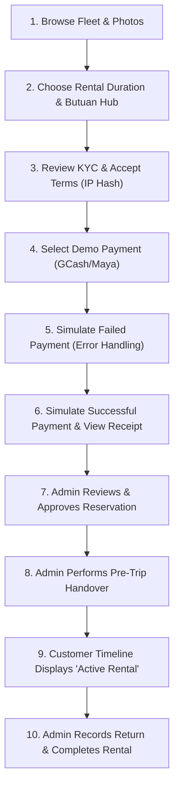

# Veyra — Final Capstone Presentation Checklist & Operations Runbook

This runbook provides technical preparation steps, environment verification instructions, demonstration account references, and troubleshooting procedures for the Veyra Car Rental System capstone defense.

---

## 1. Quick Startup & Environment Setup

### Production Live Deployment (Primary)
- **URL:** [https://veyra-tau-one.vercel.app](https://veyra-tau-one.vercel.app/)
- **Hosting:** Vercel Production
- **Database:** Supabase (`ujzaewrcjhlwpxkyfbeb.supabase.co`)

### Local Running Mode (Backup / Offline Simulation)
If presenting locally:
1. Ensure Node.js 20+ is installed:
   ```bash
   node --version
   ```
2. Verify `.env.local` contains valid Clerk and Supabase test credentials (see `.env.example`).
3. Start the Turbopack development server:
   ```bash
   npm run dev
   ```
4. Open your browser at [http://localhost:3000](http://localhost:3000).

---

## 2. Approved Demo & Test Accounts

> [!NOTE]
> All accounts use Clerk authentication in development/test mode. Passwords or verification codes follow standard test OTP conventions in the Clerk sandbox.

| Role | Account / Identifier | Purpose | Access Level |
| :--- | :--- | :--- | :--- |
| **Superadmin (Owner)** | `justine.delacerna@urios.edu.ph` | Full administrative demonstration, fleet operations, approvals, and handover | Complete `/admin/*` and `/account/*` access |
| **Staff / Admin** | `admin.dev@veyra.local` | Branch manager operations, vehicle handover, return inspections | Operational `/admin/*` access |
| **Customer 1 (Verified)** | `chloedenise.mahinay@gmail.com` | Primary customer booking, checkout, and Active Rental demonstration | `/account/*` customer portal |
| **Customer 2 (KYC Demo)** | `viboooydelacerna@gmail.com` | Demonstrating fresh KYC upload and verification workflow | `/account/*` documents portal |

---

## 3. Pre-Flight Verification Checklist (Run 15 Mins Before Presentation)

Before welcoming the panel, run through these automated and manual verification checks:

- [ ] **Run automated quality gates:**
  ```bash
  npx tsc --noEmit
  npm test
  npm run lint
  npm run build
  ```
  *Expected:* All 4 exit with code 0 (204/204 tests passing).

- [ ] **Run automated presentation readiness script:**
  ```bash
  node --env-file=.env.local scripts/verify_presentation_readiness.mjs
  ```
  *Expected:* All fleet, hub, KYC, demo payment, and lifecycle tests report `[PASS]` with clean exit.

- [ ] **Verify browser tabs are pre-opened:**
  - Tab 1: Customer View $\rightarrow$ `https://veyra-tau-one.vercel.app` (Home / Browse Vehicles)
  - Tab 2: Customer Account $\rightarrow$ `https://veyra-tau-one.vercel.app/account/reservations`
  - Tab 3: Admin Console $\rightarrow$ `https://veyra-tau-one.vercel.app/admin/reservations`
  - Tab 4: Admin Fleet / Payments $\rightarrow$ `https://veyra-tau-one.vercel.app/admin/payments`

- [ ] **Verify synthetic test documents are ready:**
  Have a sample synthetic driver's license image (PNG or JPEG, under 10 MB) on your desktop for demonstrating the document upload UI.

---

## 4. Step-by-Step Demonstration Sequence



---

## 5. How to Demonstrate Specific Features

### Feature 1: Manual Rental Duration & Pricing Synchronization
1. On vehicle booking page, change duration from 3 days to 7 days.
2. Observe:
   - Return date advances automatically by exactly 7 24-hour cycles.
   - Base rental rate multiplies accurately.
   - Quote status reflects real-time server calculation.

### Feature 2: Simulated Failed Payment & Recovery
1. On demo checkout page, click **Simulate Failed Payment (Insufficient Balance)**.
2. Observe:
   - Visual red alert indicates payment was declined.
   - Reservation remains preserved in `payment_pending`.
   - Customer can click **Retry Payment** or switch payment methods.

### Feature 3: Simulated Successful Payment & Demo Watermark
1. Click **Simulate Successful Payment**.
2. Observe:
   - Immediate success redirect to booking confirmation.
   - Prominent watermark: `DEMO — NO REAL MONEY INVOLVED`.
   - Payment method clearly displayed as `e_wallet` / `GCash Demo`.

### Feature 4: Staff Reservation Approval
1. In Admin Console (`/admin/reservations`), find the reservation in **Pending Approval** tab.
2. Click into reservation details.
3. Click **Approve Reservation**.
4. Confirm status changes to **Confirmed / Approved**.

### Feature 5: Pre-Trip Inspection & Handover
1. Click **Handover (Start Rental)**.
2. Enter valid odometer reading (e.g., `15,400 km`) and fuel level (`100%`).
3. Click **Confirm Handover**.
4. Switch to Customer View and refresh: Milestone **Active Rental** shows pulsing badge: **CURRENT STAGE**.

### Feature 6: Vehicle Return & Rental Completion
1. In Admin Console, click **Record Return**.
2. Enter return odometer (e.g., `15,680 km`) and return fuel (`95%`).
3. Select `no_damage` and submit return.
4. Click **Finalize Inspection & Release Hold**.
5. Confirm reservation status becomes **Completed** and vehicle returns to `available` fleet inventory.

---

## 6. Known Limitations (For Academic Context)

1. **Simulated Payments (By Design):** Real-money PayMongo credit card processing is intentionally deactivated (`PAYMENTS_ENABLED=false`) to ensure complete safety and zero financial liabilities during evaluation.
2. **Geographic Scope:** Operational hubs and pickup delivery boundaries are strictly focused on Butuan City, Agusan del Norte (35 km operational radius).
3. **SMS Gateway:** Automated notifications currently use in-app timeline notices and simulated email logs rather than paid regional cellular SMS gateways.

---

## 7. Troubleshooting & Emergency Procedures

| Issue / Symptom | Probable Cause | Immediate Remediation |
| :--- | :--- | :--- |
| **"Customer profile not found" on document upload** | The customer profile was not yet provisioned in Supabase. | Navigate to `/account/profile` once while logged in; the repository auto-provisions the customer profile row idempotently. |
| **Slow live deployment response** | Cold start on free-tier serverless functions. | Ping [`https://veyra-tau-one.vercel.app`](https://veyra-tau-one.vercel.app) 5 minutes prior to defense to warm the serverless instances. |
| **Network connectivity loss during presentation** | Campus Wi-Fi dropout. | Run locally via `npm run dev` at `http://localhost:3000`. The local Next.js server handles the complete demonstration. |
| **Clerk authentication modal does not open** | Third-party cookie blocking in browser incognito mode. | Use a regular browser window with cookies enabled, or use a pre-authenticated session. |
| **Accidental real-world record alteration** | Human error. | Never test on real user records. Always verify that test reservation IDs start with `HO-SMOKE-` or `DEMO-PAY-`. |
